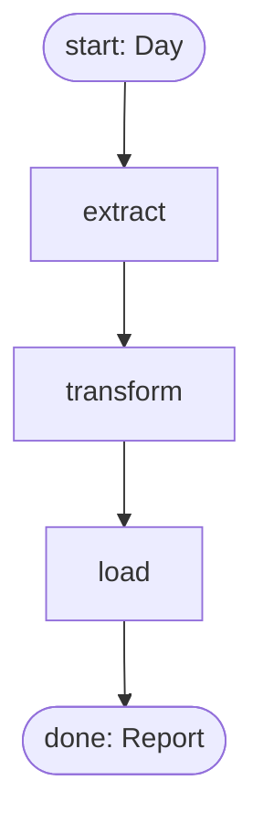
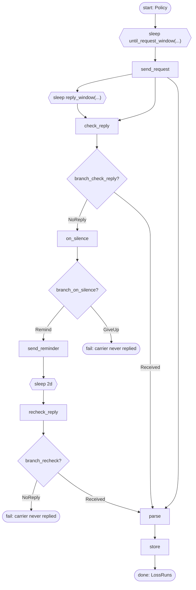
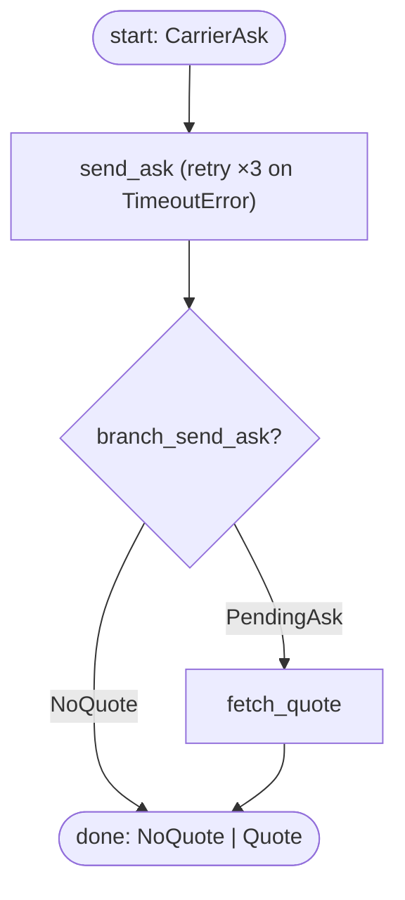
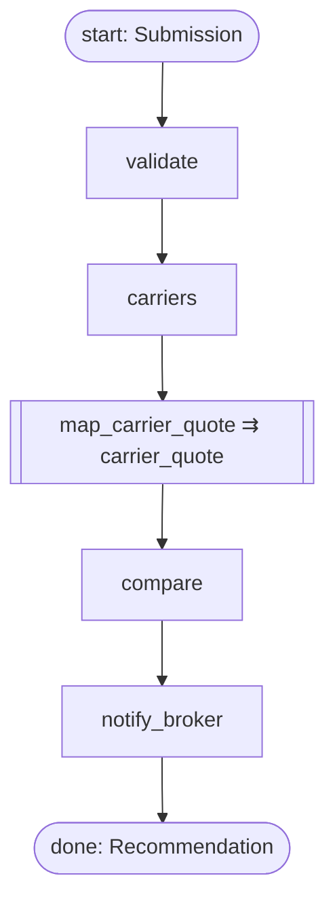
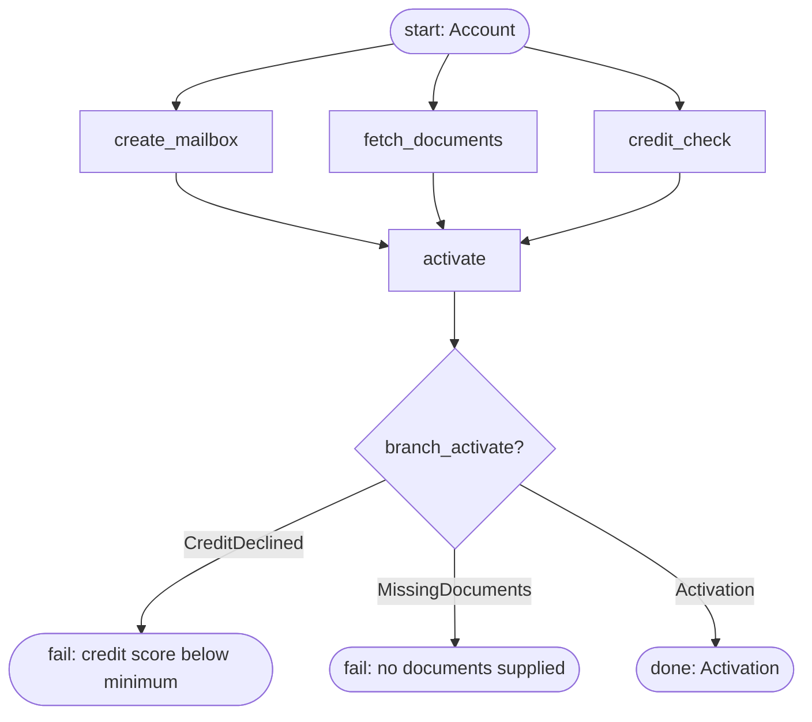
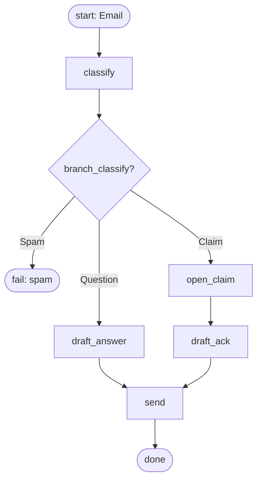
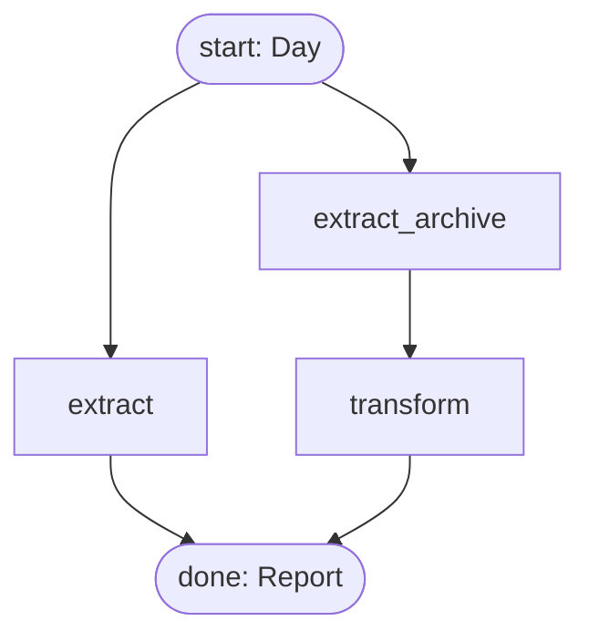
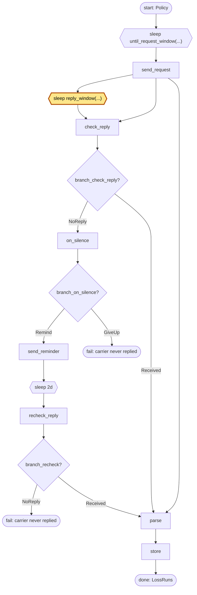

# Example jobs, drawn

Generated by `flows.draw` from the definitions in `jobs.py`.

## nightly_report

## loss_runs

## carrier_quote

## submission

## onboard

## triage

## archived_report

## loss_runs, with a run parked at wait_reply_window

